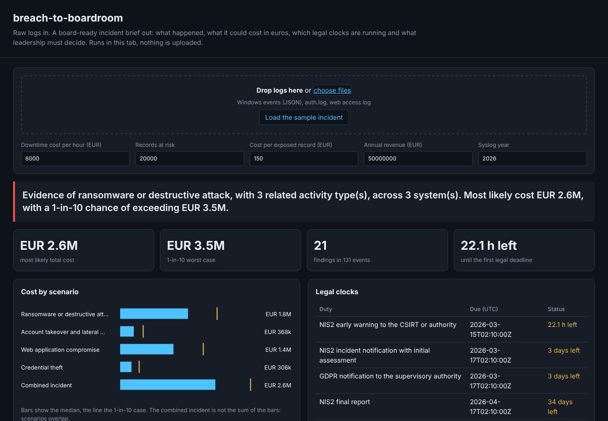

# breach-to-boardroom

[](https://github.com/jvch0512/breach-to-boardroom/actions/workflows/ci.yml)

The gap between the SOC and the boardroom is a translation problem. Analysts see event IDs; the board needs to know what happened, what it could cost, which legal clocks are running and what they have to decide today.

This takes raw logs (Windows events, Linux `auth.log`, web access logs) and produces that brief: an attack chain in plain language, a euro loss range from a Monte Carlo simulation, NIS2 and GDPR notification deadlines, decisions for leadership and the next 72 hours. Everything runs on your machine. No backend, no upload, no runtime dependencies.



## Run

```bash
npm install
npm test                       # 20 tests
npm start                      # UI on http://127.0.0.1:8787, localhost only
node dist/src/cli.js examples/win-security.jsonl examples/auth.log examples/access.log --year 2026
```

CLI: `--json`, `--year`, `--aware ISO-TIME` (when the organisation became aware; defaults to the first finding), `--set key=value` for `downtimeCostPerHour recordsAtRisk costPerRecord annualRevenue responderRate iterations seed`. Exit code 1 when a notification duty is triggered, so it can page someone from a pipeline. A real output is in [docs/sample-brief.md](docs/sample-brief.md), and CI fails if it drifts.

## How the pieces work

**Detection and chains.** The log parsers, ten ATT&CK-mapped rules and chain builder are the core of [dfir-lens](https://github.com/jvch0512/dfir-lens), vendored here so the repo stands alone.

**Incident classification.** Findings map to four categories: ransomware or destructive (recovery inhibited, or log clearing plus persistence), account takeover, web application compromise (2xx on an attack request, web shell) and credential theft.

**Loss model.** Each category has three-point estimates (min, most likely, max) for response hours, downtime hours, share of records exposed, probability and size of a fine, and legal and communications cost. A seeded simulation samples modified PERT distributions 20,000 times. Your business inputs (downtime cost per hour, records at risk, cost per record, revenue) scale it. Overlapping categories are one incident, so each cost line takes the largest matching scenario in a run instead of summing them. Adding them would double count the response and the downtime. Same seed, same numbers.

**Legal clocks.** From the moment of awareness: NIS2 early warning at 24 hours, incident notification at 72 hours, final report one month after the notification (Article 23(4)), and the GDPR notification to the supervisory authority at 72 hours (Article 33) when personal data is plausibly involved. The brief says why it judged the incident significant.

**Brief.** Headline, chain, cost table with the split by cost line, clocks, decisions, 72-hour actions, findings appendix and the assumptions used.

## Sample

`examples/` is a fictional, deterministic intrusion (documentation address ranges only). With the default business inputs it yields about EUR 2.6M as the most likely total and EUR 3.5M as the 1-in-10 case, with the first notification due 24 hours after the brute-force success.

## Safety notes

- Strict CSP (`default-src 'none'`, scripts and styles from `self`, no inline code). Log text reaches the page only through `textContent`.
- Pipes and newlines in log-derived text are escaped in the Markdown tables.
- The dev server binds to 127.0.0.1 and serves only `public/`, `dist/src` and `examples/`.

## Limits

The cost ranges are judgement values, not industry data. Every one is printed in the brief and can be overridden, and your own incident history will beat them. Detection is heuristic. Whether an incident is "significant" under NIS2 depends on national law and on facts logs cannot show. **This is decision support, not legal advice: confirm duties with counsel and the competent authority.**

MIT licensed.
